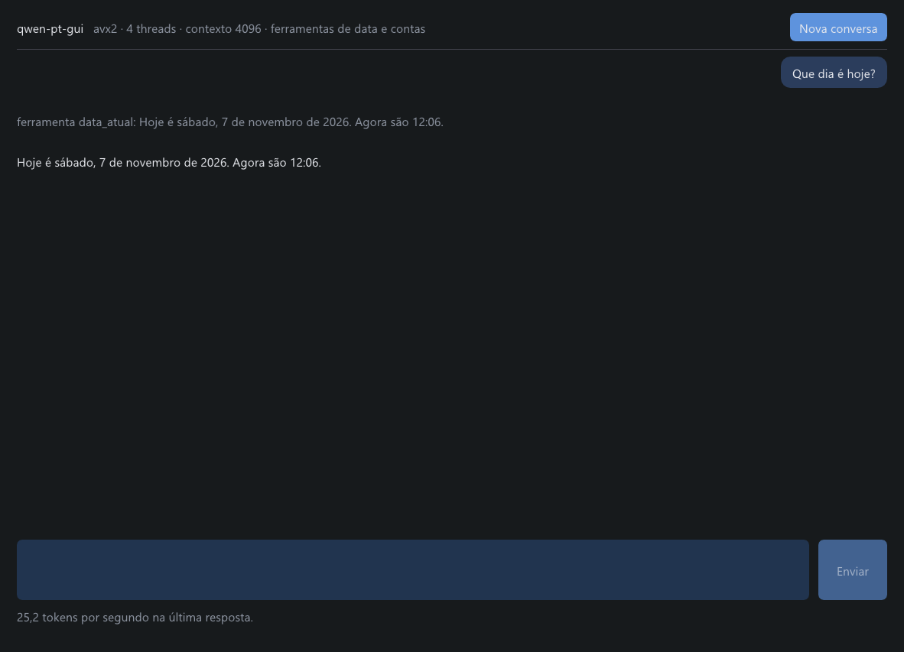

# smolmoe

Runtime de inferência de LLMs em **CPU pura**, escrito em **C99 com extensões do GCC e do Clang** (`__atomic_*`, `__builtin_cpu_supports` e `__attribute__((target))`, isoladas em `src/compat.h`). Não é C99 estrito. O cabeçalho já tem o ramo do MSVC (`Interlocked*`, `__cpuid`), mas o runtime ainda não compila com o MSVC. Empacota o motor e os pesos quantizados (`SMOEQ8` / `SMOEQ5`) em um **executável autocontido** (estilo [llamafile](https://github.com/Mozilla-Ocho/llamafile)) que roda nativamente no Windows, Linux, macOS, Android (Termux) e no navegador via WebAssembly. No Windows, um modelo que passaria de 4 GiB fica num `.smoe` ao lado do executável.

<p align="center">
  
</p>

## Destaques

- **Dependências do runtime:** `libc`, `libm` e threads nativas (`Win32` / `pthread`). Sem Python e sem CUDA. A janela no Linux e no macOS precisa da GLFW (no Windows usa o Direct3D 11 do sistema). O conversor, os testes de integração e os scripts usam [Bun](https://bun.sh); o WebAssembly pede `zig`.
- **Três interfaces sob o mesmo motor (`engine.c`):** CLI interativa no terminal, janela nativa (Dear ImGui + Direct3D 11 / OpenGL 3) e WebAssembly (SIMD128 + Web Workers).
- **Executável único (`smolmoe-bundle`):** junte runtime + pesos + tokenizer + config em um único binário pronto para rodar com duplo clique.
- **Determinismo bit a bit:** numa mesma plataforma, os logits são idênticos bit a bit para qualquer `--threads`, `--batch` e kernel (`AVX2`, `NEON`, `SIMD128` ou escalar).
- **Ferramentas nativas em C e escape de shell:** datas/feriados (`data_atual`, `dias_ate`), cálculo (`calcular`), conversão de unidades (`converter`), contagem de texto (`contar`) e execução direta de comandos no terminal com `!comando`.

---

## Início Rápido

### 1. Executável único (Recomendado)

Com um comando você baixa os pesos (verificados por SHA-256), compila o runtime otimizado e gera um executável único em `dist/`:

```sh
# Chat no terminal com Qwen2.5-0.5B Q8 (560 MB)
make qwen
./dist/qwen-pt          # Windows: .\dist\qwen-pt.exe

# Janela gráfica (GUI) com Qwen2.5-0.5B Q8
make qwen-gui
./dist/qwen-pt-gui      # Windows: .\dist\qwen-pt-gui.exe (ou duplo clique)
```

> [!TIP]
> Precisa usar menos RAM? Gere a variante **Q5 (340 MB, −39% de memória)** com `make qwen-q5` (terminal) ou `make qwen-q5-gui` (janela). Veja todos os pacotes pré-compilados em [docs/INSTALL.md](docs/INSTALL.md).

### 2. Usando o runtime `smolmoe` direto com a pasta `models/` (ou apelidos)

Tanto `build/smolmoe` (CLI) quanto `build/smolmoe-gui` (Desktop) aceitam apelidos (`qwen`, `qwen-q5`, `gemma`, `gemma-270m`, `phi`, `stories`) ou pastas de modelo e descobrem `config.ini` e `tokenizer.qbp`/`.spb` automaticamente ao lado do `.smoe`:

```sh
# Atalhos diretos via make:
make chat              # abre o chat no terminal (MODEL=qwen|qwen-q5|gemma|phi)
make run-gui           # abre a janela gráfica (MODEL=qwen|qwen-q5|gemma|phi)
make chat gemma        # abre o chat no terminal com Gemma 3 1B
make run-gui gemma     # abre a janela com Gemma 3 1B

# Ou chamando os binários diretamente por apelido ou pasta:
./build/smolmoe qwen
./build/smolmoe gemma
./build/smolmoe phi
./build/smolmoe-gui qwen
```

### 3. No navegador (WebAssembly local)

```sh
make run-web                   # compila e sobe em http://localhost:8080/
bun scripts/serve-web.ts 3000  # ou escolha a porta diretamente (ex.: http://localhost:3000/)
```

---

## Modelos Suportados

| Modelo | Parâmetros | Quantização | Tamanho | RAM aprox. | Velocidade (CPU)* | Atalho `make` / CLI | Status das Ferramentas |
|---|---:|---|---:|---:|---:|---|---|
| **Qwen2.5-0.5B-Instruct** | 0,5B | Q8_0 | 556 MB | ~0,6 GB | 22–27 tok/s | `qwen` / `make qwen` | Completas (`data_atual`, `dias_ate`, `calcular`, `converter`, `contar`) |
| **Qwen2.5-0.5B-Instruct** | 0,5B | Q5_0 | 340 MB | ~0,4 GB | 15–18 tok/s | `qwen-q5` / `make qwen-q5` | Completas (`data_atual`, `dias_ate`, `calcular`, `converter`, `contar`) |
| **Gemma-3-1B-Instruct** | 1,0B | Q8_0 | ~1,0 GB | ~1,2 GB | ~12 tok/s | `gemma` / `make gemma` | Completas (`data_atual`, `dias_ate`, `calcular`, `converter`, `contar`) |
| **Gemma-3-270M-Instruct** | 0,27B | Q8_0 | ~290 MB | não medido | não medido | CLI: `gemma-270m` | Conversão e uso com esses pesos ainda não validados ponta a ponta |
| **Phi-4-mini-instruct** | 3,8B | Q8_0 | 4,3 GB | ~4,4 GB | ~4 tok/s | `phi` / `make phi` | Completas (`data_atual`, `dias_ate`, `calcular`, `converter`, `contar`) |
| **TinyStories-15M** | 15M | Q8_0 | 27 MB | < 0,1 GB | > 200 tok/s | `stories` / `make stories` | Apenas continuação de texto em inglês (sem template de chat) |

*\*Medido em um Intel Core i7-10610U (4 núcleos físicos, AVX2). Em Apple Silicon M2 Pro (NEON, 5 threads), o Qwen2.5-0.5B Q8 atinge **64 tok/s** no decode e **148 tok/s** no prefill.*

Para converter o **Gemma 3** ou o **Phi-4-mini** a partir dos pesos originais do Hugging Face:

```sh
# Gemma 3 1B Instruct (requer HF_TOKEN com licença do Gemma aceita no Hugging Face)
make gemma-weights # baixa e converte para models/gemma-3-1b-it/
make gemma         # empacota dist/gemma-3-1b[.exe]
make gemma-gui     # empacota dist/gemma-3-1b-gui[.exe]

# Phi-4-mini Instruct (7,7 GB)
make phi-weights   # baixa e converte para models/phi-4-mini-instruct/
make phi           # empacota dist/phi-4-mini[.exe]
make phi-gui       # empacota dist/phi-4-mini-gui[.exe]
```

No Windows o executável não pode chegar a 4 GiB. `make phi` e `make phi-gui` percebem isso e gravam o runtime sem o modelo dentro, mais um `<nome>.smoe` na mesma pasta. O programa carrega esse arquivo sozinho.

Detalhes sobre manifesto, hashes SHA-256 e conversão estão em [docs/MODELS.md](docs/MODELS.md).

---

## Exemplos de Uso

### Chat interativo no terminal

Basta executar o binário sem `--prompt`. O cache KV é reaproveitado entre mensagens:

```text
$ ./dist/qwen-pt
smolmoe 0.5.0 - chat local. Digite sua mensagem; /limpar reinicia, /sair encerra.
Ferramentas: data_atual, dias_ate, calcular, converter, contar.
Comandos: !comando roda no pwsh.

> Olá! Quem escreveu Dom Casmurro?
Machado de Assis escreveu Dom Casmurro.

> /limpar
(conversa reiniciada)
```

### Resposta única para scripts e pipes

Use `--chat --prompt "..."` para responder uma vez no `stdout` (estatísticas saem em JSON no `stderr`):

```sh
./dist/qwen-pt --chat --prompt "Quanto é 7 mais 5? Responda apenas com o número."
```

Saída:

```text
12
{"version":"0.5.0","backend":"avx2","threads":4,"batch":32,...,"ttft_seconds":0.858,"prefill_tokens_per_second":79.7,...}
```

### Ferramentas nativas no chat (`data_atual`, `dias_ate`, `calcular`, `converter`, `contar`)

Modelos pequenos alucinam datas, aritmética, conversões de unidades e contagem de caracteres. No chat, o runtime em C executa as ferramentas e confere os argumentos com a pergunta. Qwen e Phi podem emitir `<tool_call>`; no Gemma, o runtime também abre chamadas para esses pedidos quando o modelo não as inicia:

```text
> Quanto tempo falta para o natal?
[ferramenta] dias_ate: {"name": "dias_ate", "arguments": {"data": "natal"}} -> {"resumo": "Faltam 49 dias para 25 de dezembro de 2026 (sexta-feira).", ...}
Para o natal, faltam 49 dias (25 de dezembro de 2026, sexta-feira).

> Quanto é 15% de 230?
[ferramenta] calcular: {"name": "calcular", "arguments": {"expressao": "15% de 230"}} -> {"resumo": "O resultado é 34,5.", ...}
O resultado é 34,5.

> Converta 100 km em milhas
[ferramenta] converter: {"name": "converter", "arguments": {"valor": 100, "de": "km", "para": "milhas"}} -> {"resumo": "100 km equivalem a 62,14 mi.", ...}
100 km equivalem a 62,14 milhas.

> Quantas letras 'r' tem na palavra morango?
[ferramenta] contar: {"name": "contar", "arguments": {"texto": "morango", "letra": "r"}} -> {"resumo": "\"r\" aparece 1 vez em \"morango\" (7 letras, 7 caracteres e 1 palavra).", ...}
A palavra "morango" tem 1 'r'.
```

- Use `--no-tools` para abrir o chat instantaneamente (~0,4 s em vez de ~5,5 s) quando não precisar de ferramentas.
- Use `--now AAAA-MM-DDTHH:MM` para fixar o relógio em testes reproduzíveis.

### Execução de comandos no shell (`!comando`)

Qualquer linha digitada começando com `!` roda diretamente no shell do sistema (`pwsh`, `powershell`, `cmd`, `bash` ou `zsh`), sem passar pelo modelo:

```text
> !git status --short
 M README.md
(código de saída 0)
> !cd src
(pasta atual: C:\Users\voce\smolmoe-c99\src)
```

> [!NOTE]
> **Proteção contra colagem maliciosa (pastejacking):** blocos de texto colados no terminal são enviados inteiros como mensagem ao modelo — linhas com `!` coladas nunca são executadas como comandos.

---

## Principais Opções da CLI (`smolmoe`)

| Opção | Padrão | Descrição |
|---|---|---|
| `--model ARQUIVO` | modelo embutido | Caminho do arquivo `.smoe` |
| `--config ARQUIVO` | embutida no `.smoe` | Caminho da `config.ini` (necessário só em `.smoe` v1/v2 sem config embutida) |
| `--tokenizer ARQUIVO` | embutido no `.smoe` | Caminho do `.qbp` ou `.spb` |
| `-i`, `--interactive` | ligado sem `--prompt` | Inicia o chat multi-turno no terminal |
| `--chat` | desligado | Aplica o template de chat de 1 turno ao usar `--prompt` |
| `--prompt TEXTO` | — | Gera uma única resposta e encerra |
| `--system TEXTO` | PT-BR curto | Define o prompt de sistema do chat |
| `--no-tools` | ferramentas ligadas | Desativa `data_atual`, `dias_ate`, `calcular`, `converter` e `contar` no chat |
| `--now AAAA-MM-DDTHH:MM` | relógio local | Fixa data/hora para as ferramentas |
| `--shell NOME\|CAMINHO` | shell pai | Define o shell usado por `!comando` (`pwsh`, `bash`, `cmd`...) |
| `--tokens N` | `64` (`512` no chat) | Máximo de novos tokens gerados |
| `--context N` | `min(modelo, 2048)` | Tamanho do cache KV em tokens |
| `--threads N` | núcleos físicos | Número de threads de trabalho |
| `--temperature X` | `0` (guloso) | Temperatura de amostragem (`> 0` ativa top-k/top-p) |
| `--top-k N` / `--top-p X` | `40` / `0.95` | Limites da amostragem estocástica |

Execute `smolmoe --help` ou `smolmoe-gui --help` para ver todas as flags de diagnóstico (`--profile`, `--perplexity`, `--trace`, `--hash-logits`).

---

## Compilação e Desenvolvimento

### Requisitos

- **Windows:** MSYS2 UCRT64 (`mingw-w64-ucrt-x86_64-gcc`) e `make` (funciona direto no PowerShell, `cmd`, Git Bash ou MSYS2).
- **Linux:** `gcc` ou `clang`, `make` (para a GUI: `g++`, `pkg-config`, `libglfw3-dev`).
- **macOS:** Xcode Command Line Tools (para a GUI: `brew install glfw`).
- **Testes e Scripts:** [Bun](https://bun.sh) (e `zig 0.13` apenas para compilar os alvos WebAssembly).

### Alvos do Makefile

```sh
make                 # Compila build/smolmoe, build/smolmoe-bundle e build/smolmoe-quantize
make gui             # Compila a janela nativa em build/smolmoe-gui
make release         # Binários otimizados e estáticos em build/release/
make all-models      # Empacota todos os executáveis autocontidos em dist/
make test            # Roda testes unitários em C + suíte de integração no Bun
make sanitize        # Roda toda a suíte sob AddressSanitizer + UndefinedBehaviorSanitizer (Linux/macOS)
make fuzz            # libFuzzer de `modelfile`, do tokenizador e da config, por alguns segundos (Clang)
make bench           # Executa o benchmark padrão (scripts/bench.ts)
make help            # Lista todos os atalhos em português
```

### Estrutura do Repositório

```text
src/          Runtime em C99 com extensões GCC/Clang (plataforma, compat.h, kernels SIMD, modelo, tokenizers, ferramentas, engine e CLI)
gui/          Interface gráfica em C++17 com Dear ImGui (Win32 + Direct3D 11 / GLFW + OpenGL 3)
web/          Aplicação web em TypeScript sobre o build WebAssembly (WASI + SIMD128)
scripts/      Conversor de modelos Hugging Face (convert.ts), download, benchmark e avaliação (Bun)
tests/        Testes unitários em C e testes de integração / paridade numérica em TypeScript
docs/         Documentação detalhada de arquitetura, formato binário, modelos e decisões
```

---

## Arquitetura e Desempenho

| Métrica (i7-10610U, Qwen2.5-0.5B Q8, prompt de 88 tokens) | v0.1 | **Atual** |
|---|---:|---:|
| Tempo até o primeiro token (TTFT) | 29,0 s | **1,3 s** |
| Velocidade de leitura (Prefill) | 3,0 tok/s | **67–71 tok/s** |
| Velocidade de escrita (Decode) | 2,0 tok/s | **22–26 tok/s** |
| Consumo de heap (além dos pesos via `mmap`) | 1024 MiB | **22 MiB** |
| Perplexidade (texto PT-BR, 164 tokens) | 5,2750 | **5,2774 (+0,05%)** |

1. **Pesos mapeados direto do disco (`mmap` / `MapViewOfFile`):** sem cópia em RAM e sem cache duplicado.
2. **Produto escalar inteiro exato (Q8/Q5):** ativações quantizadas em blocos de 32 valores e acumulação float em ordem fixa de 8 lanes — reproduzida bit a bit nos kernels escalar, `AVX2`, `NEON` e `SIMD128`.
3. **Prefill em lote e Threadpool estático:** processa múltiplos tokens por leitura de linha de peso e particiona o trabalho de forma determinística entre os núcleos físicos.
4. **Validação na carga:** shapes, escalas e extents do `.smoe` são conferidos na abertura. O alinhamento do offset de cada tensor não é exigido: as leituras aceitam endereço sem alinhamento. Cada saída de produto matriz-vetor ainda passa por `isfinite`, para recusar um checkpoint fora da faixa numérica.

---

## Documentação Complementar

- **[docs/CAMINHOS.md](docs/CAMINHOS.md)** — Guia completo comparando cada modo de execução (CLI, GUI, Web, pacotes únicos) por sistema operacional.
- **[docs/INVENTARIO.md](docs/INVENTARIO.md)** — `smolmoe-inventario`: inventário defensivo só leitura da máquina (portas, usuários, SUID, persistência, chaves SSH) e comparação entre inventários.
- **[docs/PLANO-DEFESA.md](docs/PLANO-DEFESA.md)** — Plano e revisão do uso defensivo.
- **[docs/INSTALL.md](docs/INSTALL.md)** — Download e verificação dos binários prontos do GitHub Releases.
- **[docs/DESKTOP.md](docs/DESKTOP.md)** — Uso, atalhos e detalhes técnicos da interface gráfica (Dear ImGui).
- **[docs/WEB.md](docs/WEB.md)** — Como compilar e servir a versão WebAssembly no navegador.
- **[docs/MODELS.md](docs/MODELS.md)** — Como baixar, verificar ou converter modelos (Qwen2.5, Gemma 3, Phi-4-mini, Q5) do Hugging Face.
- **[docs/FORMAT.md](docs/FORMAT.md)** — Especificação binária dos contêineres `SMOEQ8`/`SMOEQ5` (v1, v2, v3), tokenizers (`SMQBP1`, `SMSPB1`) e trailer `SMOEBDL1`.
- **[docs/DECISIONS.md](docs/DECISIONS.md)** — Histórico de engenharia, benchmarks A/B e experimentos descartados.
- **[docs/ROADMAP.md](docs/ROADMAP.md)** — Próximos passos de otimização, novos modelos e ferramentas.
- **[CONTRIBUTING.md](CONTRIBUTING.md)** — Como compilar, o estilo do C e o que os testes cobrem.
- **[SECURITY.md](SECURITY.md)** — Como reportar uma falha ao abrir um arquivo de modelo.

## Licença

Código-fonte sob licença [MIT](LICENSE). Os pesos convertidos mantêm as condições de uso do modelo original (Apache-2.0 para Qwen2.5; Gemma Terms of Use para Gemma 3; MIT para Phi-4-mini e TinyStories); consulte [docs/MODELS.md](docs/MODELS.md) e [THIRD_PARTY.md](THIRD_PARTY.md).
