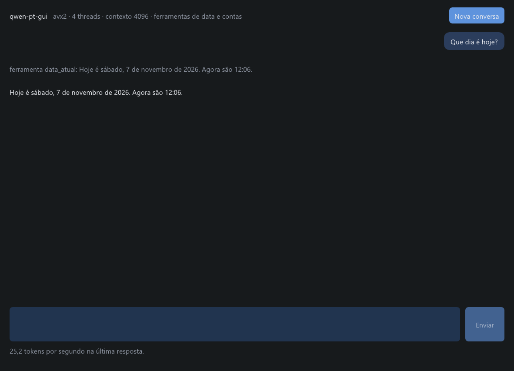
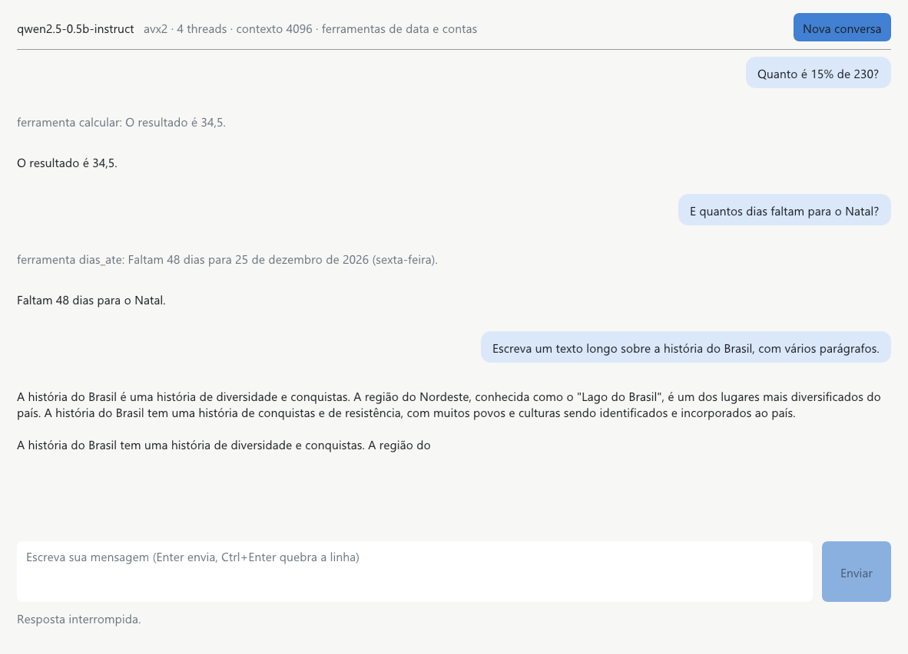

# smolmoe numa janela

`smolmoe-gui` é o chat numa janela. Ele usa o mesmo motor de conversa do terminal e da página web (`src/engine.c`),
os mesmos padrões (menos o contexto, que aqui é 4096) e as mesmas ferramentas de data e de conta. Ela escreve quase
na velocidade do terminal: 20 a 25 tokens/s com o Qwen no notebook de testes, contra 23 a 27 no terminal. Nada sai
do computador.



## Abrir

| Sistema | Como |
|---|---|
| **Windows** | Baixe `qwen-pt-gui-windows-x64.exe` do Release e dê dois cliques: o programa e o Qwen estão no mesmo arquivo. Também há o `smolmoe-gui-windows-x64.exe` só com o programa, que abre um `.smoe` (veja abaixo). Os dois entram no Release a partir da primeira versão depois da 0.3.1; até lá, compile com `make gui` no MSYS2. |
| **Linux** | Compile: `sudo apt install g++ make pkg-config libglfw3-dev` (ou os pacotes equivalentes da sua distribuição) e depois `make gui`. |
| **macOS** | Compile: `brew install glfw` e depois `make gui`. |

Os passos para baixar do Release (o repositório é privado) estão em [INSTALL.md](INSTALL.md). No Windows, como o
binário não tem assinatura digital, o SmartScreen pode avisar na primeira vez: "Mais informações" e "Executar assim
mesmo".

### De onde vem o modelo

A janela procura o modelo nesta ordem:

1. **Um arquivo na linha de comando:** `smolmoe-gui modelo.smoe`. No Windows, também vale arrastar o `.smoe` para cima
   do `.exe`.
2. **O modelo embutido no próprio executável**, como no `qwen-pt-gui`. Para montar um com outro modelo:
   `smolmoe-bundle --model ... --config ... --tokenizer ... --exe smolmoe-gui.exe --out meu-chat.exe`.
3. **Escolhido na janela:**
   - no Windows, pelo botão "Abrir modelo (.smoe)…";
   - no Linux e no macOS, digitando o caminho;
   - em todos os sistemas, arrastando o arquivo para a janela.

Servem dois formatos de modelo:
- um `.smoe` autocontido, como os do Release (`qwen2.5-0.5b-instruct-q8.smoe`);
- um `model.smoe` com `config.ini` e `tokenizer.qbp` (ou `.spb`) na mesma pasta, o formato de `models/<nome>/`
  depois de `bun scripts/fetch-models.ts`.

Um arquivo que não é modelo, ou um modelo sem chat, como o TinyStories, é recusado na primeira tela com o motivo, e
dá para escolher outro.

## Usar



| Tecla ou ação | O que faz |
|---|---|
| Enter | Envia a mensagem |
| Ctrl+Enter (Cmd+Enter no macOS) | Quebra a linha |
| Esc ou o botão **Parar** | Interrompe a resposta. O que já foi escrito fica na conversa e no histórico do modelo. |
| Ctrl+N (Cmd+N no macOS) ou **Nova conversa** | Começa do zero, sem reprocessar as instruções do modelo |
| Botão direito numa mensagem | Copiar |

- **Dá para digitar enquanto o modelo responde.** Nesse meio-tempo, o Enter não envia: o texto fica no campo. O Esc
  nunca apaga o rascunho.
- **Os avisos das ferramentas** aparecem em cinza, já resumidos ("ferramenta calcular: O resultado é 34,5.").
- **A barra de baixo** mostra a velocidade da última resposta.
- **Parada no meio de uma ferramenta:** se a resposta for interrompida enquanto o modelo escreve uma chamada de
  ferramenta, a mensagem inteira sai do histórico, e a janela avisa. Assim o histórico nunca guarda uma chamada sem
  resultado.

O `!comando` do terminal não existe na janela.

### Opções

```sh
smolmoe-gui [MODELO.smoe] [--context N] [--threads N]
```

- `--context N`: posições do cache KV. O padrão é 4096 (o terminal usa 2048), limitado ao máximo do modelo.
- `--threads N`: threads de cálculo. O padrão são os núcleos físicos.
- `--version` e `--help` escrevem no terminal. No Windows, isso foi testado com a saída redirecionada.

| Variável de ambiente | Efeito |
|---|---|
| `SMOLMOE_GUI_THEME=claro` ou `escuro` (ou `light`, `dark`) | Força o tema. Sem ela, o Windows segue o tema escolhido para os apps; no Linux e no macOS o tema é escuro. |
| `SMOLMOE_GUI_FONT=/caminho/fonte.ttf` | Usa outra fonte TrueType. Por padrão: Segoe UI no Windows, DejaVu Sans, Noto Sans ou Liberation Sans no Linux, Arial no macOS. |
| `SMOLMOE_GUI_SCREENSHOT=arquivo.bmp` | Só no Windows: o F12 grava o próximo quadro nesse arquivo, lido direto do Direct3D, mesmo com a janela coberta ou a tela bloqueada. As imagens desta página saíram assim. |

## Construir

```sh
make gui            # build/smolmoe-gui[.exe]
make release-gui    # build/release/smolmoe-gui[.exe]: otimizado, sem símbolos, estático no Windows
```

- **Requisitos:** um compilador C++17 (g++ ou clang++) além do C99 do resto.
  - **Windows:** o MSYS2 UCRT64 com `mingw-w64-ucrt-x86_64-gcc`, que já traz o g++ e os cabeçalhos do Direct3D 11.
  - **Linux e macOS:** a GLFW 3.3 ou mais nova e o `pkg-config` (no macOS, sem ele, o Makefile procura a GLFW do
    Homebrew).
- **Windows:** o `.exe` de release é estático e só depende de DLLs que vêm com o Windows 10 e 11, inclusive o
  `D3DCOMPILER_47.dll`.
- **Linux e macOS:** o binário usa a GLFW e o OpenGL do sistema, e por isso ainda não vai no Release (veja os limites).

## Como funciona

| Peça | Arquivo | Papel |
|---|---|---|
| Motor | `src/engine.c` | A conversa: ferramentas, rollback de chamadas, limites de contexto e agora o "parar" (`sink.stop`). |
| Modelo para a janela | `src/desktop.c` | Abre o modelo nos três formatos, devolve como mensagem os erros esperados e resume os avisos das ferramentas. C99, testado em `tests/test_desktop.c`. |
| Sessão | `gui/session.cpp` | Uma thread de trabalho é dona do motor e atende a uma fila de pedidos. A janela lê a conversa sob um mutex e nunca trava esperando o modelo. |
| Telas | `gui/view.cpp` | Escolha do modelo, abertura, conversa e erro, em Dear ImGui. |
| Sistema | `gui/platform_win32.cpp`, `gui/platform_glfw.cpp` | Janela e desenho: Win32 + Direct3D 11, ou GLFW + OpenGL 3. Também o seletor de arquivo, arrastar e soltar, o DPI e o tema. |
| Interface gráfica | `third_party/imgui/` | Dear ImGui 1.91.9b (MIT), copiado sem mudanças. A origem e o SHA-256 estão em [THIRD_PARTY.md](../THIRD_PARTY.md). |

- **Parar sem estragar o histórico.** O motor consulta o `sink.stop` antes de cada token. Se a parada cai dentro de uma
  chamada de ferramenta, o cache KV volta ao início da mensagem. O teste prova isso: depois de uma chamada
  interrompida, a mesma pergunta recebe exatamente a resposta de uma conversa nova.
- **Erro fatal sem fechar a janela.** O runtime encerra com `die()` em erros que não deveriam acontecer, como um
  arquivo corrompido. Na janela, um gancho no `die()` estaciona a thread que falhou, e a janela mostra a mensagem com
  um botão "Fechar". Os erros esperados (arquivo que não existe, que não é modelo, modelo sem chat) nem chegam ao
  `die()`: voltam como mensagem, e dá para escolher outro arquivo.
- **Sem gastar CPU à toa.** Sem nada acontecendo, a janela dorme até chegar um evento, ou por até meio segundo (o cursor do campo pisca). Durante a abertura e as
  respostas, ela redesenha a cada quadro da tela.

## Testes

- **Automáticos** (`make test`, e no CI nos três sistemas):
  - em C: o resumo dos avisos, a leitura do resultado das ferramentas e os arquivos recusados;
  - com o Qwen: parar no meio do texto, parar no meio de uma chamada de ferramenta com o histórico intacto, e a pasta
    com `config.ini`;
  - no programa da janela: `--version`, `--help` e linha de comando inválida, que sai com erro no stderr sem abrir a
    janela.
- **Compilação:** o CI compila a janela no Windows (Win32 + Direct3D 11), no Linux (GLFW + OpenGL) e no macOS
  (GLFW + OpenGL).
- **À mão, no Windows 11, em 2026-11-07:** com mensagens do Windows enviadas por script e capturas pelo F12. Foram
  conferidos:
  - as quatro telas;
  - o chat com as três ferramentas;
  - o Esc parando a resposta e preservando o rascunho;
  - o Enter, que não envia enquanto a resposta é escrita;
  - o tema claro e o escuro;
  - o `qwen-pt-gui` abrindo o modelo embutido;
  - o arquivo recusado e o arquivo corrompido.

## Limites atuais

- **Linux e macOS:** compilados no CI, mas ainda não abertos à mão, e fora do Release, porque dependem da GLFW do
  sistema.
- **Mouse e Ctrl+N não testados à mão:** a tela da máquina de teste estava bloqueada, e o Windows não entrega um
  cursor real a uma janela nessas condições. O teclado e o Esc foram testados.
- **Mudança de DPI com a janela aberta** (arrastar para outro monitor) reconstrói as fontes, mas não foi testada.
- **Acessibilidade:** o Dear ImGui desenha tudo sozinho, então leitores de tela não enxergam a janela. Para usar com
  leitor de tela, use o chat do terminal.
- **Uma conversa por janela,** que não fica salva ao fechar.
- **Depois de um erro fatal** é preciso fechar e abrir de novo.
